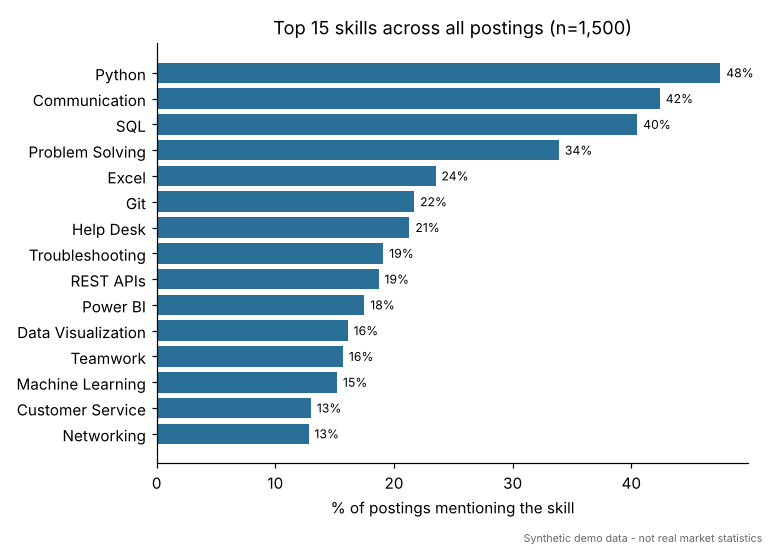
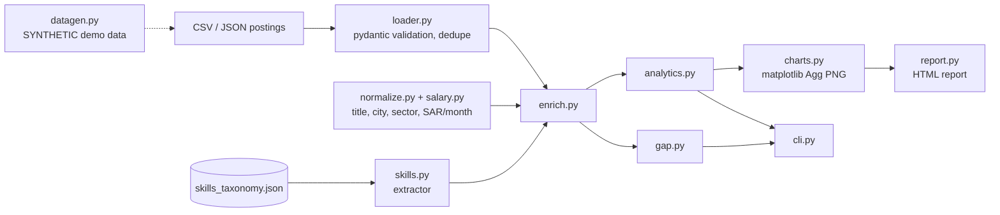
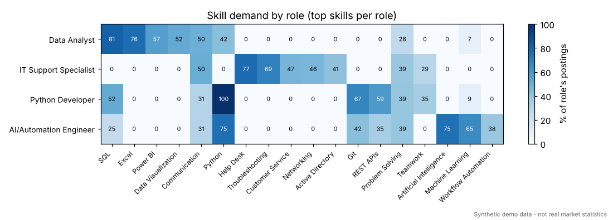
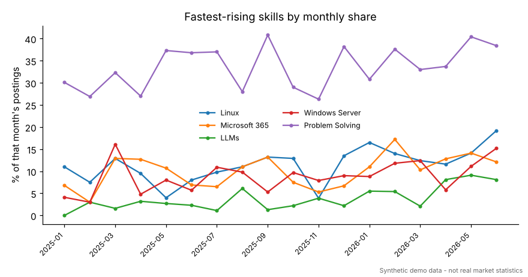
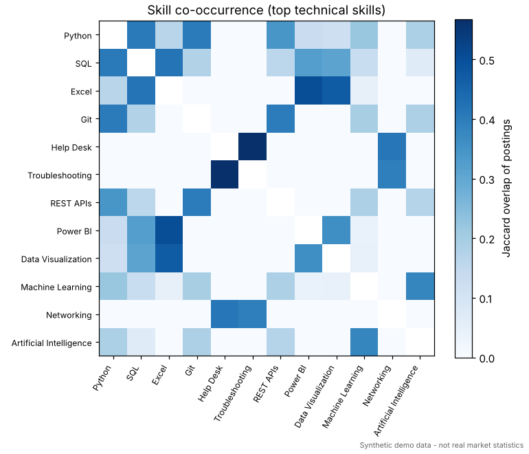
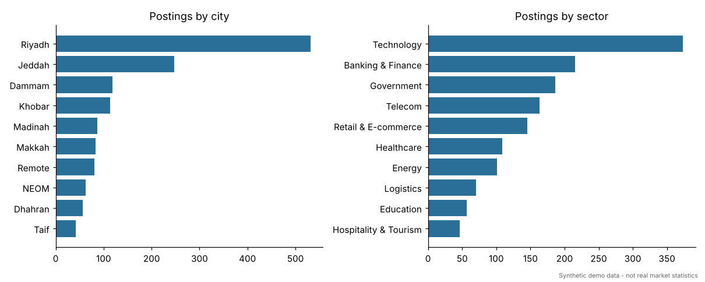

# Saudi Job Market Analyzer

Job-posting analytics for IT, data and AI roles: bilingual (English + Arabic) skill extraction, title / city / sector
normalisation, salary parsing, skill-demand analytics and a skills-gap tool. Python, pandas, matplotlib, pydantic.

> **The bundled demo dataset is SYNTHETIC.** It is produced by `saudi_jobs/datagen.py` with invented parameters. Every
> number in this README, in `docs/` and in the demo output comes from that generated data and says **nothing** about the
> real Saudi job market. Every generated report and CLI run says so at the top. See [`docs/DATA_SOURCES.md`](docs/DATA_SOURCES.md)
> for how to use real data responsibly.

**ملخص بالعربية:** أداة لتحليل إعلانات الوظائف (تقنية المعلومات والبيانات والذكاء الاصطناعي) تستخرج المهارات من النصوص العربية والإنجليزية (مثل بايثون وإكسل وباور بي آي)، وتوحّد المسميات الوظيفية والمدن والقطاعات، وتحلل الرواتب، وتعرض أكثر المهارات طلبًا، والمهارات التي تظهر معًا، واتجاه الطلب شهريًا، وأداة لتحديد الفجوة بين مهاراتك والوظيفة المستهدفة. **بيانات العرض التجريبي اصطناعية بالكامل (مولَّدة بالكود) وليست إحصاءات حقيقية لسوق العمل السعودي.** لا يتضمن المشروع أي أداة لجمع البيانات من المواقع.



## Features

- **Skill extractor** with an editable JSON taxonomy ([`saudi_jobs/data/skills_taxonomy.json`](saudi_jobs/data/skills_taxonomy.json)):
  7 categories, 83 skills (languages, data tools, cloud/DevOps, AI/automation, networking/IT support, certifications such
  as Google IT Support / CCNA / Security+, soft skills) with English and Arabic aliases. Matching is case-insensitive,
  Arabic-normalised (alef / teh-marbuta folding, diacritics removed, Arabic-Indic digits) and word-boundary safe
  (`Java` is not found in `JavaScript`, `AI` not in `maintain`). Arabic single-letter prefixes such as `بالاكسل` are handled.
- **Normalisation** of job titles to four roles (Data Analyst, IT Support Specialist, Python Developer, AI/Automation Engineer;
  everything else is `Other`), Saudi cities (Riyadh, Jeddah, Makkah, Madinah, Dammam, Khobar, Taif, NEOM and more, plus `Remote`),
  sectors and seniority, from English or Arabic text.
- **Salary parsing** to SAR per month: ranges, `k` suffix, Arabic digits, monthly vs annual (stated, or inferred when unstated
  and flagged as inferred). Non-SAR currencies and hourly/daily pay are rejected rather than guessed.
- **Analytics:** top skills overall and per role, co-occurrence matrix and pair lift, monthly skill-demand trend and
  rising/falling skills, city / sector breakdown with median advertised salary, seniority split by role, data-quality summary.
- **Skills-gap tool:** your skills (English or Arabic) + a target role -> missing skills ranked by their share of that role's
  postings, tiered Must-have (>= 50%) / Important (>= 25%) / Nice-to-have, plus a coverage figure.
- **Outputs:** CLI (`analyze`, `gap`, `skills`, `generate`), self-contained HTML report (inline base64 PNG charts, no scripts),
  PNG charts in `docs/`.
- Validation with pydantic: bad rows are reported, not fatal; exact duplicates are removed.
- 44 pytest tests.

## Architecture



## Quickstart

```bash
python -m pip install -r requirements.txt   # numpy, pandas, matplotlib, pydantic, pytest
python scripts/demo.py                      # generate synthetic data -> analyse -> charts -> HTML report -> gap
python -m pytest -q
```

Open `docs/sample_report.html` in a browser (generated by the demo and committed as a sample).

## Usage

```bash
python -m saudi_jobs generate --n 1500 --seed 42 --out data/sample_postings.csv   # SYNTHETIC data
python -m saudi_jobs analyze data/sample_postings.csv --out output/report.html
python -m saudi_jobs gap data/sample_postings.csv --skills "Python,إكسل,Git" --role "Data Analyst"
python -m saudi_jobs skills data/sample_postings.csv --role "AI/Automation Engineer" --top 6
python -m saudi_jobs skills --text "مطلوب محلل بيانات يجيد بايثون وباور بي آي, CCNA preferred"
```

Add `--taxonomy my_taxonomy.json` to any command to use your own skill list (same structure as the bundled file:
category -> canonical skill -> extra aliases; an alias may belong to one skill only). `gap --json` prints machine-readable output.

Real output on the synthetic demo data (1,500 generated postings, seed 42):

```text
$ python -m saudi_jobs gap data/sample_postings.csv --skills "Python,إكسل,Git" --role "Data Analyst" --top 6
!! SYNTHETIC DEMO DATA. These postings were generated by a script with invented parameters. Nothing in this report describes the real Saudi job market.

Target role: Data Analyst (462 postings)
You cover 20.0% of the role's top-10 skills; 1.1% of postings list skills you half-match or better.

Skills you have that this role asks for:
 skill               category  share_pct
 Excel Data & Analytics Tools       76.2
Python  Programming Languages       42.2

Learning priority (missing skills, most demanded first):
 priority              skill               category  share_pct      tier
        1                SQL  Programming Languages       81.0 Must-have
        2           Power BI Data & Analytics Tools       56.7 Must-have
        3 Data Visualization Data & Analytics Tools       52.2 Must-have
        4         Statistics Data & Analytics Tools       34.4 Important
        5      Data Cleaning Data & Analytics Tools       29.7 Important
        6            Tableau Data & Analytics Tools       27.9 Important

$ python -m saudi_jobs skills --text "مطلوب محلل بيانات يجيد بايثون وباور بي آي, CCNA preferred"
["CCNA", "Power BI", "Python"]
```

`python scripts/demo.py` headline numbers (all synthetic): 1,500 postings, 45.2% with a parseable salary, 3.0% unclassified
role, 1.5% with no skill found. Top skills by share of postings: Python 47.5%, Communication 42.4%, SQL 40.5%,
Problem Solving 33.9%, Excel 23.5%. Median advertised monthly salary (midpoint, SAR) by role in the generated data:
Data Analyst 10,750; IT Support Specialist 7,750; Python Developer 14,250; AI/Automation Engineer 16,500.
These reflect the salary parameters the generator was given, not a real salary survey.

### Charts (synthetic data)

| | |
|---|---|
|  |  |
|  |  |

The generator plants rising demand for a few skills (e.g. LLMs, Generative AI, Prompt Engineering), so the trend chart
can show them. The "rising / falling" table also contains pure sampling noise (e.g. Linux, Microsoft 365 appear in it
although the generator gives them no trend), which is a reminder to treat small shifts in real data with caution.

## Project structure

```text
saudi_jobs/
  textnorm.py     Arabic/English text normalisation and word-boundary regex builder
  skills.py       Taxonomy (validated, editable) and SkillExtractor
  normalize.py    title -> role, city, sector, seniority
  salary.py       salary text/columns -> SAR per month
  loader.py       CSV/JSON loading, pydantic validation, de-duplication
  enrich.py       adds normalised columns + skills to the frame
  analytics.py    top skills, co-occurrence, trends, breakdowns, data quality
  gap.py          skills-gap ranking
  charts.py       matplotlib Agg charts       report.py   self-contained HTML
  datagen.py      SYNTHETIC data generator    cli.py      argparse CLI
  data/skills_taxonomy.json
scripts/demo.py   data/sample_postings.csv (synthetic)   docs/   charts, sample report, DATA_SOURCES.md
tests/            44 tests
```

## Testing

```bash
python -m pytest -q
```

Tests cover word-boundary and Arabic matching, taxonomy editing and validation, title/city/sector/seniority normalisation,
salary parsing edge cases, loader rejection and de-duplication, analytics consistency, the gap tool, report contents
(synthetic notice before the first heading, five inline images, no scripts) and the CLI end to end. On the synthetic data the
extractor recovers 99.6% of the skills the generator wrote into the text (measured on all 1,500 postings; precision 97.8%,
the difference being skills that also appear in titles). This only shows the extractor reads text the generator wrote;
it is not an accuracy claim for real postings.

## Limitations

- **Synthetic demo data.** No conclusion about the real Saudi market can be drawn from the demo. Real postings are messier
  (mixed languages, boilerplate, images instead of text, duplicates across sites).
- **Dictionary matching, not understanding.** A skill is "found" if one of its aliases appears in the title or description,
  including in phrases like "no Python needed" or in company boilerplate. Skills missing from the taxonomy are invisible.
  The taxonomy was written by hand and is not exhaustive; the Arabic aliases are limited to common spellings.
- **Title text counts as a mention** (e.g. the Arabic title "أخصائي دعم فني" yields Help Desk).
- **Rule-based title normalisation.** Only four target roles; anything else is `Other`. Ambiguous titles follow rule order
  (e.g. "AI Data Analyst" -> AI/Automation Engineer).
- **Salary:** only SAR is accepted; when the text names no period, values of 40,000 or more are assumed annual (flagged
  `period_inferred`). Advertised ranges are not actual pay, and only postings that state a salary contribute.
- **Gap tool** ranks by how often a skill is mentioned for a role, not by how much it matters in hiring or pay.
  The 'half-matched postings' figure is a rough indicator.
- Postings are not weighted by company or deduplicated across sources; only exact duplicates are removed.
- Charts use English labels only. No scraper is included on purpose.

## Roadmap

- Fuzzy / stem-based Arabic matching and a larger reviewed alias list
- Negation handling ("no experience in X") and required vs preferred skill split
- Cross-source de-duplication and an `--since` date filter
- Salary percentiles by role and city once enough postings state a salary
- Optional Arabic-capable chart fonts

## License

MIT, see [LICENSE](LICENSE).
